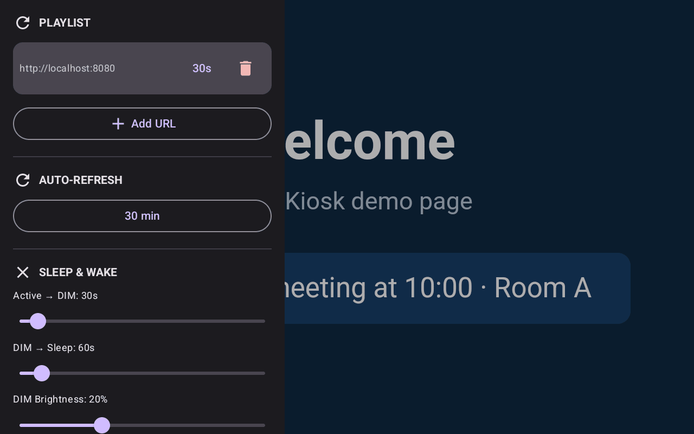
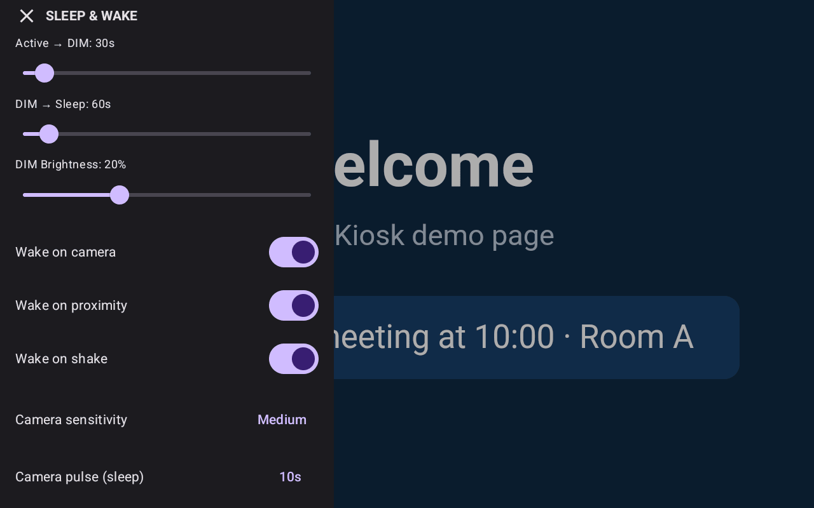
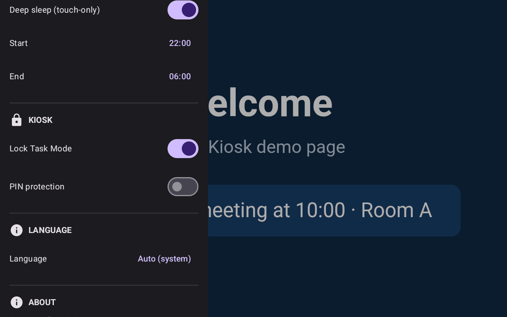
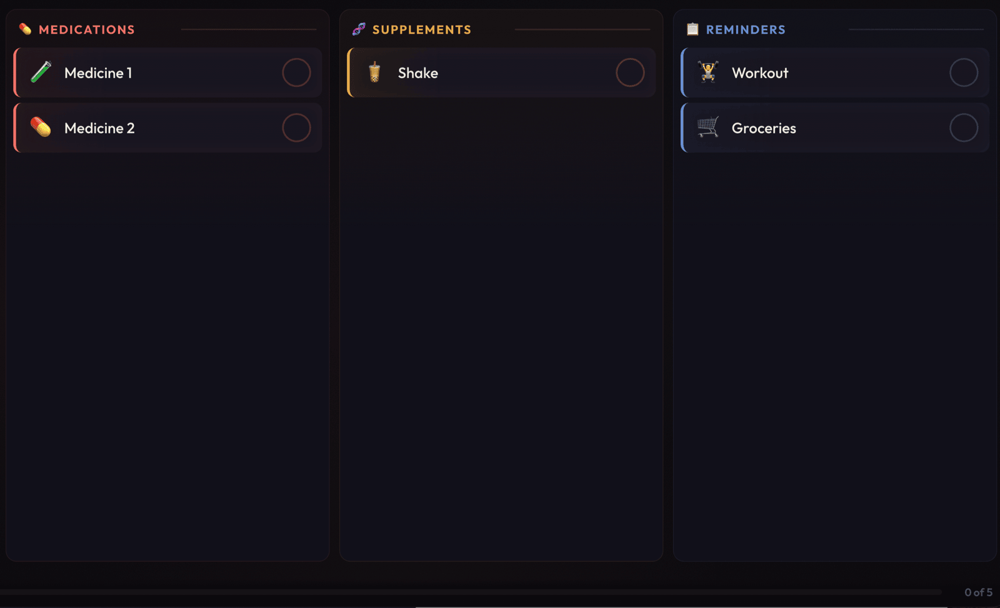
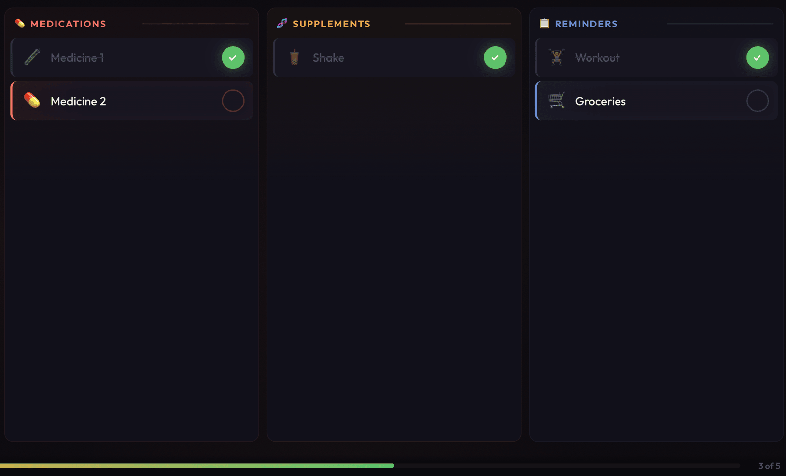

# Open Kiosk

Open-source Android kiosk browser for wall-mounted tablets and digital signage: a lightweight alternative to Fully Kiosk Browser, tested on an Amazon Fire HD 8.

**English** · [Português](README.pt-BR.md)

[](https://github.com/pedroberaldo87/open-kiosk/actions/workflows/build.yml)
[](LICENSE)
[](https://developer.android.com/about/versions/pie)



## Features

- **URL playlist**: several URLs, each with its own display time (10 s to 5 min), rotated automatically. With an empty playlist the app opens `https://www.google.com`.
- **Kiosk mode (optional, off by default)**: when switched on in the settings, the watchdog keeps the kiosk in front, the app opens on boot, Back is blocked, and Lock Task Mode is used when the app is device owner. Off, the tablet stays yours: Back leaves the app and nothing pulls it back.
- **Sleep and wake without turning the screen off**: ACTIVE → DIM → SLEEP by timeouts, plus a scheduled DEEP_SLEEP window. The screen is dimmed and covered by a black overlay, never switched off, so sensors keep running. The state is saved to disk, so a relaunch comes back dark if the panel was asleep.
- **Camera presence detection**: CameraX, Y-plane frame comparison, with compensation for global light changes so the panel dimming is not mistaken for a person.
- **Power-aware camera**: on mains power the camera analyses continuously; on battery it pulses at the interval you choose.
- **Other wake triggers**: accelerometer shake, proximity sensor (when the tablet has one) and touch.
- **Watchdog service**: with kiosk mode on, a foreground service brings the kiosk back to the front when another app covers it, with backoff from 5 s to 60 s.
- **Web recovery**: WebView crash recovery, error retries with backoff (5 s, 15 s, 30 s, 60 s), optional auto-refresh, offline screen.
- **Settings drawer**: swipe in from the left edge; optional 4-digit PIN (off by default).
- **Languages**: English, Portuguese and Spanish, picked automatically or from the drawer.

## Tested hardware

- Amazon Fire HD 8 (model `KFRAPWI`, Fire OS on an Android 11 base), wall-mounted and on mains power.

Checked on that device: the full ACTIVE → DIM → SLEEP cycle without a false wake as the panel dims, the mains/battery switch changing the camera duty cycle, the watchdog bringing the app back after another app covered it, and a real movement waking the screen. Device owner is not available on a retail Fire; see [Provisioning a retail Fire tablet](#provisioning-a-retail-fire-tablet).

The settings screens and the ADB commands below were also checked on an Android 14 emulator (arm64). Camera motion detection can't be tested there, because the virtual camera is static.

## Requirements

- Android 9 or newer (API 28). `compileSdk` and `targetSdk` are 34.
- A front camera is optional. Without one, only shake, proximity and touch can wake the screen.
- To build: JDK 17 and the Android SDK (platform 34). The Gradle wrapper downloads Gradle 8.9.

## Installation

### Build

If there is no JDK 17 on your path, the one bundled with Android Studio works on macOS:

```bash
export JAVA_HOME="/Applications/Android Studio.app/Contents/jbr/Contents/Home"
```

Point Gradle at the Android SDK with `ANDROID_HOME`, or with `sdk.dir` in `local.properties`. Then:

```bash
# Debug APK (about 56 MB)
./gradlew assembleDebug

# Release APK (about 2.4 MB, needs a signing config, see below)
./gradlew assembleRelease
```

### Install

```bash
adb install -r app/build/outputs/apk/debug/app-debug.apk
```

Debug and release APKs are signed with different keys. To switch from one to the other, run `adb uninstall com.openkiosk` first.

### Release signing

`assembleRelease` always signs with the `release` config, so it fails if the keystore is missing. Create `local.properties` in the project root (it is git-ignored):

```properties
signing.storeFile=../keystore/open-kiosk.jks
signing.storePassword=your-password
signing.keyAlias=openkiosk
signing.keyPassword=your-key-password
```

The path is relative to the `app/` folder, so the line above points to `keystore/open-kiosk.jks` in the project root (also git-ignored). To create that keystore:

```bash
mkdir keystore
keytool -genkeypair -v -keystore keystore/open-kiosk.jks \
  -keyalg RSA -keysize 2048 -validity 10000 -alias openkiosk
```

### Permissions

| Permission | Why |
| --- | --- |
| `INTERNET`, `ACCESS_NETWORK_STATE` | Load pages and show the offline screen |
| `CAMERA` | Presence detection (optional) |
| `WAKE_LOCK`, `FOREGROUND_SERVICE`, `FOREGROUND_SERVICE_SPECIAL_USE`, `POST_NOTIFICATIONS` | Watchdog foreground service |
| `USE_FULL_SCREEN_INTENT`, `SYSTEM_ALERT_WINDOW` | Let the watchdog start the kiosk activity from the background |
| `RECEIVE_BOOT_COMPLETED` | Launch the kiosk after a reboot |
| `WRITE_SECURE_SETTINGS` | Only granted over ADB; lets the watchdog switch off the Fire lock-screen ad |

## Device owner setup

For full lockdown (blocks Home, recents and the status bar), make the app device owner on a device with no accounts configured (factory reset or fresh setup):

```bash
adb shell dpm set-device-owner com.openkiosk/.receiver.KioskDeviceAdminReceiver
```

Without device owner the app falls back to immersive sticky mode, which is less restrictive but needs no setup.

**There is no ADB command to undo this.** `dpm remove-active-admin` is refused for this app (`SecurityException: Attempt to remove non-test admin`) and the app can't be uninstalled while it is device owner. If you need to hand the device back, plan on a factory reset. Both behaviours were reproduced on an Android 14 emulator.

## Provisioning a retail Fire tablet

On a retail Fire the device owner command fails with `Trying to set the device owner, but the user already has a profile owner`: Amazon's Parental Controls already hold that slot, and the tablet ships with accounts. Short of a factory reset, device owner is not available.

These commands, run over the USB cable, cover most of what a kiosk needs:

```bash
# screen never sleeps while powered (AC | USB | wireless)
adb shell settings put global stay_on_while_plugged_in 7

# no lock screen (this is what shows the ads on a Fire)
adb shell locksettings set-disabled true

# REQUIRED: without this, Android blocks the watchdog's background activity start
adb shell appops set com.openkiosk SYSTEM_ALERT_WINDOW allow

# grant the camera up front; an unattended panel has nobody to tap a dialog
adb shell pm grant com.openkiosk android.permission.CAMERA

# lets the watchdog turn the lock-screen ad off again when Fire OS re-enables it
adb shell pm grant com.openkiosk android.permission.WRITE_SECURE_SETTINGS

# try to make the kiosk the launcher so Home returns to it (see the note below)
adb shell cmd package set-home-activity com.openkiosk/.presentation.MainActivity
```

- Without the `SYSTEM_ALERT_WINDOW` grant, the watchdog can't bring the app back.
- `set-home-activity` answers `Success`, but on Fire OS 8.3.3.8 it has no effect: Home still opens Amazon's launcher. The watchdog is what brings the kiosk back, in about 6 seconds.
- These settings live on the device, not in the APK. Reinstalling keeps them; a factory reset or a new tablet needs them again.
- `com.amazon.kindle.kso` (Special Offers) is a protected package, so `pm disable-user` is refused. The lock-screen switch above is the way around the ads.

## Configuration

Swipe in from the left edge of the screen to open the settings drawer. The drawer only opens while the screen is ACTIVE, so touch the panel first if it is dimmed. If PIN protection is on, you are asked for the PIN first.

| Section | Setting | Options | Default |
| --- | --- | --- | --- |
| Playlist | URLs, each with a display time | 10, 15, 30, 60, 120 or 300 s | 30 s per new item |
| Auto-refresh | Reload interval | Disabled, 5, 10, 15, 30 or 60 min | 30 min |
| Sleep & Wake | Active → DIM timeout | 10 to 300 s | 30 s |
| | DIM → Sleep timeout | 10 to 600 s | 60 s |
| | DIM brightness | 5 to 50 % | 20 % |
| | Wake on camera | on / off | on |
| | Wake on proximity | on / off | on |
| | Wake on shake | on / off | on |
| | Camera sensitivity | Low, Medium, High | Medium |
| | Camera pulse (battery only) | 5, 10, 15, 20, 30 or 60 s | 10 s |
| | Deep sleep (touch-only) | on / off, start and end hour | off, 22:00 to 06:00 |
| Kiosk | Kiosk mode (keep in front, open on boot, block Back) | on / off | off |
| | PIN protection | on / off | off |
| | Change PIN | 4 digits, not 0000; asks for the current PIN | none (you choose one when turning protection on) |
| Language | Language | Auto (system), English, Português, Español | Auto |




Notes:

- "Disabled" auto-refresh really stops the timer, including one that was already armed.
- Many tablets, the Fire HD 8 included, have no proximity sensor. The app logs it and carries on.
- Settings are stored in a local Room database on the device. There is no remote configuration.

## Usage

1. Install the APK and open Open Kiosk. Grant the camera permission when asked, or grant it over ADB as above.
2. Swipe in from the left edge, add one or more URLs to the playlist and pick the display time of each.
3. Adjust the sleep timeouts and wake triggers, then close the drawer.
4. With more than one URL the app rotates through them. With one URL it stays on that page.

Looking for something to put on the screen? [Daily Screen](https://github.com/pedroberaldo87/daily-screen) is a daily checklist made for the same tablet (Fire HD 8, 1280×800, landscape):





## How it works

### Sleep and wake

The state machine has four states:

1. **ACTIVE**: normal brightness, content shown, sensors off.
2. **DIM**: reduced brightness, content still visible, camera analysing continuously.
3. **SLEEP**: brightness at 0 plus a black overlay. It looks off, but the app stays alive. Camera continuous on mains power, pulsed on battery.
4. **DEEP_SLEEP**: looks like SLEEP but is entered by a time window (for example 22:00 to 06:00) instead of by timeout. All sensors are off; only touch wakes it.

The screen is never turned off at the OS level. That keeps the sensors and camera running, so presence wakes the screen at once. The state is written to disk on every transition, so a process death followed by a relaunch comes back in the same state instead of flashing a bright panel at 3 am. While no activity is attached, the state machine freezes instead of advancing; otherwise it would record a SLEEP that no panel ever showed, and the watchdog would read that as "do not light up".

### Camera motion detection

The front camera captures 320×240 frames. Each frame's Y-plane (grayscale luminance) is compared with the previous one, but the median of the per-pixel differences is subtracted first. A change that hits the whole frame uniformly (the panel dimming, a lamp switching, auto-exposure drifting) moves that median and cancels out. What survives is a change in some region of the image, that is, something that moved. Frames captured right after the camera binds are discarded while auto-exposure converges.

The wake threshold is the fraction of pixels that changed after that subtraction:

| Sensitivity | Pixels changed |
| --- | --- |
| High | 3 % |
| Medium (default) | 5 % |
| Low | 8 % |

On mains power the analyser runs continuously. On battery it pulses: a 2.5 s capture window every N seconds, with N from the settings. The camera stays bound between pulses and only the analyser is detached, so a longer gap saves CPU, not sensor power.

Field calibration: `PIXEL_THRESHOLD` in `MotionDetectionAnalyzer.kt` is the per-pixel knob. Raise it if the panel wakes by itself in the dark; lower it if it misses people in dim light. To see the raw signal:

```bash
adb logcat -s MotionDetection:D    # changeRatio against the active threshold
```

### Code layout

Single Gradle module: Kotlin, Jetpack Compose, CameraX, Room and Hilt. Min SDK 28, target SDK 34.

```
com.openkiosk/
  presentation/    # MainActivity, Compose screens, ViewModels
  domain/          # PlaylistManager, models
  data/            # Room database, repositories, preferences
  sensors/         # CameraX motion detection, accelerometer and proximity wake
  sleep/           # screen state machine (ACTIVE / DIM / SLEEP / DEEP_SLEEP)
  power/           # mains-vs-battery monitor (drives the camera duty cycle)
  service/         # foreground watchdog that keeps the kiosk in front
  kiosk/           # Lock Task Mode management
  webview/         # WebView recovery manager
  receiver/        # boot receiver, device admin receiver
  di/              # Hilt modules
```

### Debugging

```bash
# Everything that decides when the screen lights up
adb logcat -s KioskViewModel:D MotionDetection:D SensorWake:D ScreenState:D KioskWatchdog:D PowerState:D
```

Some log messages are in Portuguese. They are quoted here as they appear:

- `changeRatio=0.00042 (limiar=0.0500)`: the camera signal against the active threshold. In a still room it should sit far below the threshold.
- `SLEEP — na tomada: camera continua` / `SLEEP — na bateria: camera pulsada`: which duty cycle is active.
- `MainActivity fora do topo — relançando`: the watchdog saw something covering the kiosk.
- `Atividade sem activity anexada — maquina de estado congelada`: a transition was refused because no window was attached.

## Development

These are the checks CI runs:

```bash
./gradlew testDebugUnitTest lintDebug assembleDebug
```

The unit tests live in `app/src/test`, run on the JVM and need no device. At the time of writing, all 39 pass, lint passes, and `assembleDebug` and `assembleRelease` (with a signing config) both build. There are no instrumented tests in CI.

Build instructions, code style and the PR checklist are in [CONTRIBUTING.md](CONTRIBUTING.md). Notes for coding agents are in [`.claude/CLAUDE.md`](.claude/CLAUDE.md) and [`.claude/docs/`](.claude/docs/) (in Portuguese).

## Security

Please report vulnerabilities privately; see [SECURITY.md](SECURITY.md). Known limitations to weigh before deploying:

- PIN protection is off by default (an owner decision: the PIN is not mandatory on first run). It cannot be turned on while the PIN is the old default 0000. The PIN is stored as a salted PBKDF2-HMAC-SHA256 hash and wrong guesses are rate limited (from the fifth wrong guess, a lockout that starts at 30 s, doubles and is capped at 1 h; it survives restarts). It is still a 4-digit lock for the settings drawer, not a security boundary.
- The WebView only navigates to the hosts of your start URL and playlist (subdomains included); links and redirects to other hosts are blocked, and the kiosk then shows a local "Address not allowed" page with the blocked host. If your page signs in through another host (Google or Microsoft SSO, an OAuth provider) or redirects to another name, add that host as a playlist entry. Add the narrowest host you need: a shared-hosting apex opens every site under it. A host written with accents or other non-Latin letters (for example `bücher.example`) is matched through its punycode form. WebSocket connections are not restricted. Plain `http://` loads only for private/LAN hosts (RFC 1918, loopback, link-local, `.local`, `.lan`, single-label names) or for hosts you added as `http://` yourself (the app warns when you add one on a public host). The OS-level network security config still permits cleartext, because it cannot express IP ranges or hosts typed in at runtime. Use HTTPS for anything sensitive.
- CI builds and uploads only a debug APK. There is no signed release.

## Contributing

See [CONTRIBUTING.md](CONTRIBUTING.md). This project follows the [Contributor Covenant](CODE_OF_CONDUCT.md).

## License

[GNU General Public License v3.0](LICENSE).
