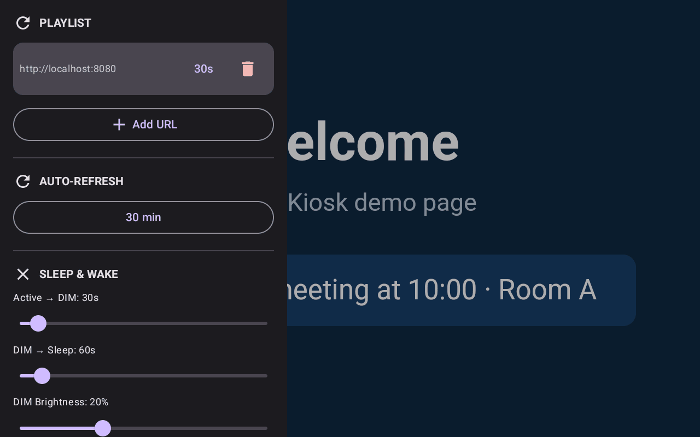
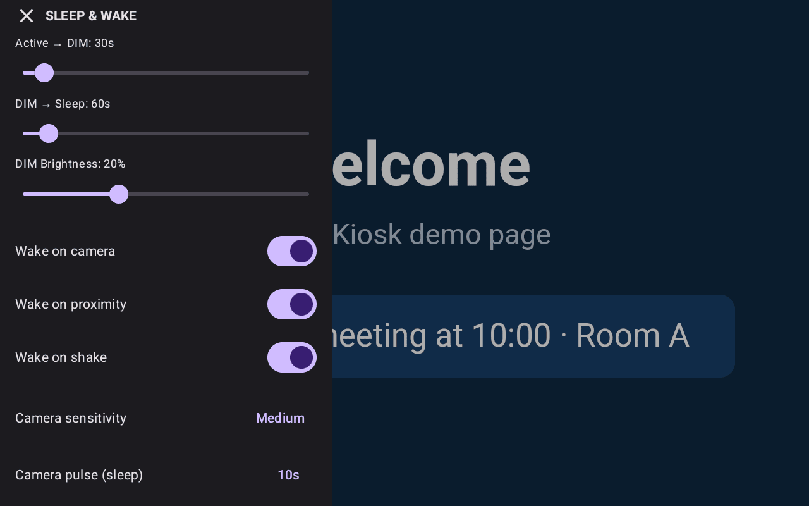
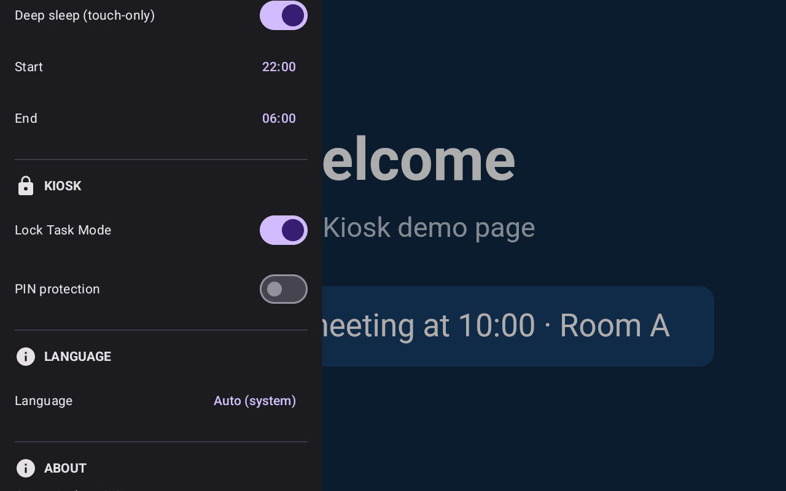
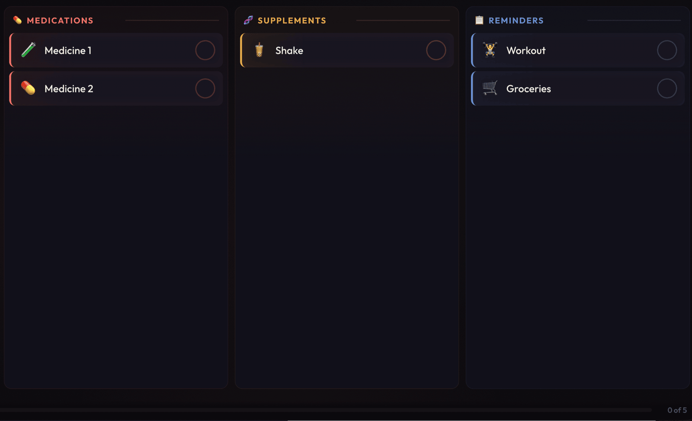
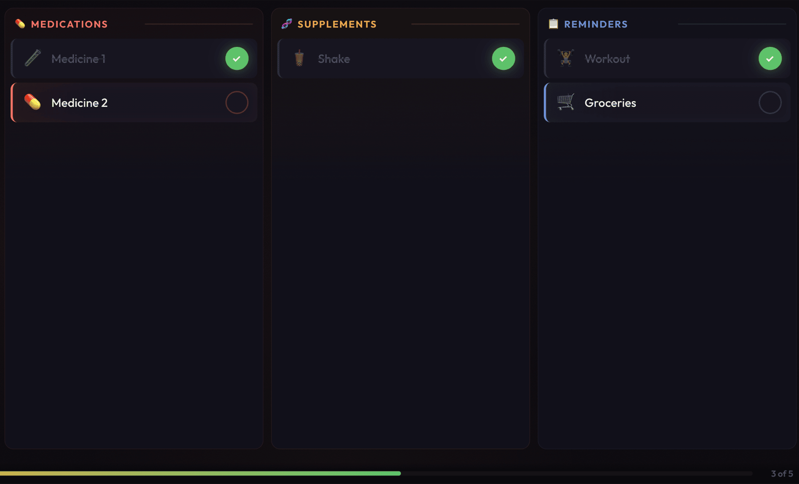
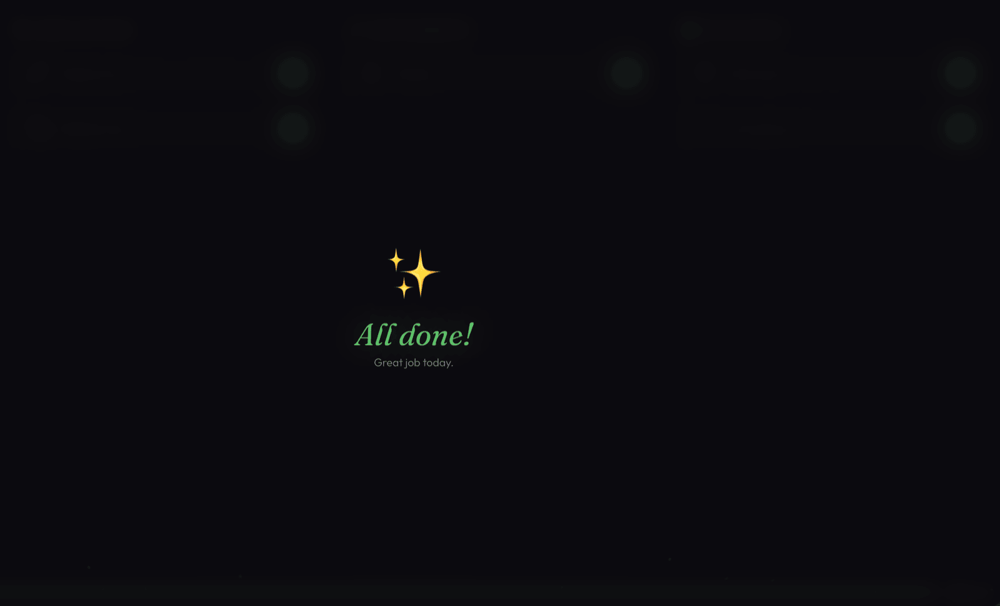

# Open Kiosk

Navegador de quiosque para Android, de código aberto, feito para tablets fixos na parede e letreiros digitais: uma alternativa leve ao Fully Kiosk Browser, testada num Amazon Fire HD 8.

[English](README.md) · **Português**

[](https://github.com/pedroberaldo87/open-kiosk/actions/workflows/build.yml)
[](LICENSE)
[](https://developer.android.com/about/versions/pie)



## Recursos

- **Playlist de URLs**: várias URLs, cada uma com seu tempo na tela (de 10 s a 5 min), em rodízio automático. Com a playlist vazia, o app abre `https://www.google.com`.
- **Modo quiosque (opcional, vem desligado)**: ligado nas configurações, o vigia mantém o quiosque na frente, o app abre no boot, o Voltar fica bloqueado e o Lock Task Mode é usado quando o app é device owner. Desligado, o tablet continua seu: o Voltar sai do app e nada o puxa de volta.
- **Suspender e acordar sem desligar a tela**: ACTIVE → DIM → SLEEP por tempo, mais uma janela agendada de DEEP_SLEEP. A tela é escurecida e coberta por uma sobreposição preta, nunca desligada, então os sensores continuam funcionando. O estado é gravado em disco: se o painel estava dormindo, o app reaberto volta escuro.
- **Detecção de presença pela câmera**: CameraX, comparação de quadros no plano Y, com compensação de mudança global de luz para que o escurecimento do próprio painel não seja confundido com uma pessoa.
- **Câmera consciente da energia**: na tomada, a câmera analisa sem parar; na bateria, ela pulsa no intervalo que você escolher.
- **Outros gatilhos para acordar**: sacudir (acelerômetro), sensor de proximidade (quando o tablet tem um) e toque.
- **Serviço vigia**: com o modo quiosque ligado, um serviço em primeiro plano traz o quiosque de volta para a frente quando outro app o cobre, com espera crescente de 5 s até 60 s.
- **Recuperação da web**: recuperação de queda da WebView, novas tentativas após erro com espera crescente (5 s, 15 s, 30 s, 60 s), atualização automática opcional e tela de sem conexão.
- **Gaveta de configurações**: deslize a partir da borda esquerda; PIN de 4 dígitos opcional (desligado por padrão).
- **Idiomas**: inglês, português e espanhol, escolhidos automaticamente ou pela gaveta.

## Hardware testado

- Amazon Fire HD 8 (modelo `KFRAPWI`, Fire OS sobre base Android 11), fixo na parede e ligado na tomada.

Conferido nesse aparelho: o ciclo completo ACTIVE → DIM → SLEEP sem despertar falso quando o painel escurece, a troca tomada/bateria mudando o ciclo da câmera, o vigia trazendo o app de volta depois que outro app o cobriu e um movimento real acendendo a tela. Device owner não está disponível num Fire de varejo; veja [Preparando um tablet Fire de varejo](#preparando-um-tablet-fire-de-varejo).

As telas de configurações e os comandos ADB abaixo também foram conferidos num emulador Android 14 (arm64). A detecção de movimento pela câmera não dá para testar lá, porque a câmera virtual é estática.

## Requisitos

- Android 9 ou mais novo (API 28). `compileSdk` e `targetSdk` são 34.
- Câmera frontal é opcional. Sem ela, só sacudir, proximidade e toque acordam a tela.
- Para compilar: JDK 17 e o Android SDK (plataforma 34). O Gradle wrapper baixa o Gradle 8.9.

## Instalação

### Compilar

Se você não tem um JDK 17 no PATH, o que vem no Android Studio serve no macOS:

```bash
export JAVA_HOME="/Applications/Android Studio.app/Contents/jbr/Contents/Home"
```

Aponte o Gradle para o Android SDK com `ANDROID_HOME` ou com `sdk.dir` no `local.properties`. Depois:

```bash
# APK de debug (cerca de 56 MB)
./gradlew assembleDebug

# APK de release (cerca de 2,4 MB, precisa de assinatura, veja abaixo)
./gradlew assembleRelease
```

### Instalar

```bash
adb install -r app/build/outputs/apk/debug/app-debug.apk
```

Os APKs de debug e de release são assinados com chaves diferentes. Para trocar de um para o outro, rode antes `adb uninstall com.openkiosk`.

### Assinatura de release

O `assembleRelease` sempre assina com a configuração `release`, então falha se o keystore não existir. Crie o `local.properties` na raiz do projeto (ele está no `.gitignore`):

```properties
signing.storeFile=../keystore/open-kiosk.jks
signing.storePassword=sua-senha
signing.keyAlias=openkiosk
signing.keyPassword=senha-da-chave
```

O caminho é relativo à pasta `app/`, então a linha acima aponta para `keystore/open-kiosk.jks` na raiz do projeto (também no `.gitignore`). Para criar esse keystore:

```bash
mkdir keystore
keytool -genkeypair -v -keystore keystore/open-kiosk.jks \
  -keyalg RSA -keysize 2048 -validity 10000 -alias openkiosk
```

### Permissões

| Permissão | Para quê |
| --- | --- |
| `INTERNET`, `ACCESS_NETWORK_STATE` | Carregar páginas e mostrar a tela de sem conexão |
| `CAMERA` | Detecção de presença (opcional) |
| `WAKE_LOCK`, `FOREGROUND_SERVICE`, `FOREGROUND_SERVICE_SPECIAL_USE`, `POST_NOTIFICATIONS` | Serviço vigia em primeiro plano |
| `USE_FULL_SCREEN_INTENT`, `SYSTEM_ALERT_WINDOW` | Deixar o vigia abrir a activity do quiosque a partir do segundo plano |
| `RECEIVE_BOOT_COMPLETED` | Abrir o quiosque depois de reiniciar |
| `WRITE_SECURE_SETTINGS` | Só concedida por ADB; permite que o vigia desligue o anúncio de tela de bloqueio do Fire |

## Configurar como device owner

Para o bloqueio completo (trava Home, recentes e barra de status), torne o app device owner num aparelho sem contas configuradas (restauração de fábrica ou configuração inicial):

```bash
adb shell dpm set-device-owner com.openkiosk/.receiver.KioskDeviceAdminReceiver
```

Sem device owner, o app cai para o modo imersivo fixo, que restringe menos mas não exige preparo nenhum.

**Não existe comando ADB para desfazer isso.** O `dpm remove-active-admin` é recusado para este app (`SecurityException: Attempt to remove non-test admin`) e o app não pode ser desinstalado enquanto for device owner. Se precisar devolver o aparelho, conte com uma restauração de fábrica. Os dois comportamentos foram reproduzidos num emulador Android 14.

## Preparando um tablet Fire de varejo

Num Fire de varejo, o comando de device owner falha com `Trying to set the device owner, but the user already has a profile owner`: o Controle Parental da Amazon já ocupa essa vaga, e o tablet já vem com contas. Sem restauração de fábrica, device owner não está disponível.

Estes comandos, rodados pelo cabo USB, cobrem a maior parte do que um quiosque precisa:

```bash
# a tela nunca apaga sozinha enquanto está na tomada (AC | USB | wireless)
adb shell settings put global stay_on_while_plugged_in 7

# sem tela de bloqueio (é ela que mostra os anúncios no Fire)
adb shell locksettings set-disabled true

# OBRIGATÓRIO: sem isso, o Android bloqueia o início de activity em segundo plano pelo vigia
adb shell appops set com.openkiosk SYSTEM_ALERT_WINDOW allow

# conceda a câmera de antemão; num painel sem ninguém por perto, não há quem toque no diálogo
adb shell pm grant com.openkiosk android.permission.CAMERA

# deixa o vigia desligar de novo o anúncio de tela de bloqueio quando o Fire OS o religa
adb shell pm grant com.openkiosk android.permission.WRITE_SECURE_SETTINGS

# tenta fazer do quiosque a tela inicial, para o Home voltar a ele (veja a nota abaixo)
adb shell cmd package set-home-activity com.openkiosk/.presentation.MainActivity
```

- Sem a concessão de `SYSTEM_ALERT_WINDOW`, o vigia não consegue trazer o app de volta.
- O `set-home-activity` responde `Success`, mas no Fire OS 8.3.3.8 não tem efeito: o Home continua abrindo o launcher da Amazon. Quem traz o quiosque de volta é o vigia, em cerca de 6 segundos.
- Esses ajustes ficam no aparelho, não no APK. Reinstalar o app os mantém; restauração de fábrica ou um tablet novo exige aplicá-los de novo.
- O `com.amazon.kindle.kso` (Special Offers) é um pacote protegido, então o `pm disable-user` é recusado. O interruptor da tela de bloqueio acima é o caminho para escapar dos anúncios.

## Configuração

Deslize a partir da borda esquerda da tela para abrir a gaveta de configurações. A gaveta só abre com a tela em ACTIVE; se o painel estiver escurecido, toque nele primeiro. Se a proteção por PIN estiver ligada, o PIN é pedido antes.

| Seção | Ajuste | Opções | Padrão |
| --- | --- | --- | --- |
| Playlist | URLs, cada uma com um tempo na tela | 10, 15, 30, 60, 120 ou 300 s | 30 s por item novo |
| Atualização automática | Intervalo de recarga | Desativado, 5, 10, 15, 30 ou 60 min | 30 min |
| Suspensão e despertar | Tempo de Active → DIM | 10 a 300 s | 30 s |
| | Tempo de DIM → Sleep | 10 a 600 s | 60 s |
| | Brilho em DIM | 5 a 50 % | 20 % |
| | Acordar pela câmera | ligado / desligado | ligado |
| | Acordar por proximidade | ligado / desligado | ligado |
| | Acordar ao sacudir | ligado / desligado | ligado |
| | Sensibilidade da câmera | Baixa, Média, Alta | Média |
| | Pulso da câmera (só na bateria) | 5, 10, 15, 20, 30 ou 60 s | 10 s |
| | Deep sleep (só toque) | ligado / desligado, hora de início e de fim | desligado, 22:00 às 06:00 |
| Quiosque | Modo quiosque (manter na frente, abrir no boot, bloquear Voltar) | ligado / desligado | desligado |
| | Proteção por PIN | ligado / desligado | desligado |
| | Trocar PIN | 4 dígitos, diferente de 0000; pede o PIN atual | nenhum (você escolhe um ao ligar a proteção) |
| Idioma | Idioma | Auto (sistema), English, Português, Español | Auto |

Os nomes dos controles na interface seguem o idioma escolhido; as capturas de tela abaixo foram feitas com a interface em inglês.




Observações:

- Atualização automática em "Desativado" realmente para o relógio, inclusive um que já estivesse armado.
- Muitos tablets, o Fire HD 8 entre eles, não têm sensor de proximidade. O app registra isso no log e segue em frente.
- As configurações ficam num banco Room local, no próprio aparelho. Não há configuração remota.

## Uso

1. Instale o APK e abra o Open Kiosk. Conceda a permissão da câmera quando pedida, ou conceda por ADB como acima.
2. Deslize a partir da borda esquerda, adicione uma ou mais URLs à playlist e escolha o tempo de cada uma.
3. Ajuste os tempos de suspensão e os gatilhos de despertar, e feche a gaveta.
4. Com mais de uma URL, o app alterna entre elas. Com uma só, fica nessa página.

Procurando algo para colocar na tela? O [Daily Screen](https://github.com/pedroberaldo87/daily-screen) é uma lista diária feita para o mesmo tablet (Fire HD 8, 1280×800, paisagem):





## Como funciona

### Suspensão e despertar

A máquina de estados tem quatro estados:

1. **ACTIVE**: brilho normal, conteúdo à mostra, sensores desligados.
2. **DIM**: brilho reduzido, conteúdo ainda visível, câmera analisando sem parar.
3. **SLEEP**: brilho em 0 mais uma sobreposição preta. Parece apagada, mas o app continua vivo. Câmera contínua na tomada, pulsada na bateria.
4. **DEEP_SLEEP**: parece SLEEP, mas se entra por uma janela de horário (por exemplo, 22:00 às 06:00) e não por tempo parado. Todos os sensores ficam desligados; só o toque acorda.

A tela nunca é desligada no nível do sistema. Isso mantém sensores e câmera funcionando, e a presença acende a tela na hora. O estado é gravado em disco a cada transição, então uma morte do processo seguida de nova abertura volta no mesmo estado, em vez de acender o painel às 3 da manhã. Enquanto nenhuma activity está anexada, a máquina de estados congela em vez de avançar; se não fosse assim, ela gravaria um SLEEP que nenhum painel chegou a mostrar, e o vigia leria isso como "não acenda".

### Detecção de movimento pela câmera

A câmera frontal captura quadros de 320×240. O plano Y (luminância em tons de cinza) de cada quadro é comparado com o anterior, mas antes se subtrai a mediana das diferenças por pixel. Uma mudança que atinge o quadro inteiro de modo uniforme (o painel escurecendo, uma lâmpada acendendo, a exposição automática oscilando) desloca essa mediana e se cancela. O que sobra é mudança numa região da imagem, ou seja, algo que se mexeu. Os quadros capturados logo depois que a câmera é ligada são descartados enquanto a exposição automática se estabiliza.

O limiar para acordar é a fração de pixels que mudaram depois dessa subtração:

| Sensibilidade | Pixels alterados |
| --- | --- |
| Alta | 3 % |
| Média (padrão) | 5 % |
| Baixa | 8 % |

Na tomada, o analisador roda sem parar. Na bateria, ele pulsa: uma janela de captura de 2,5 s a cada N segundos, com N vindo das configurações. A câmera continua ligada entre os pulsos e só o analisador é desacoplado, então um intervalo maior economiza CPU, não energia do sensor.

Calibração em campo: `PIXEL_THRESHOLD`, em `MotionDetectionAnalyzer.kt`, é o ajuste por pixel. Suba o valor se o painel acordar sozinho no escuro; baixe se ele deixar de notar pessoas com pouca luz. Para ver o sinal bruto:

```bash
adb logcat -s MotionDetection:D    # changeRatio contra o limiar ativo
```

### Organização do código

Módulo Gradle único: Kotlin, Jetpack Compose, CameraX, Room e Hilt. Min SDK 28, target SDK 34.

```
com.openkiosk/
  presentation/    # MainActivity, telas Compose, ViewModels
  domain/          # PlaylistManager, modelos
  data/            # banco Room, repositórios, preferências
  sensors/         # detecção de movimento com CameraX, despertar por acelerômetro e proximidade
  sleep/           # máquina de estados da tela (ACTIVE / DIM / SLEEP / DEEP_SLEEP)
  power/           # monitor tomada x bateria (define o ciclo da câmera)
  service/         # vigia em primeiro plano que mantém o quiosque na frente
  kiosk/           # gerenciamento do Lock Task Mode
  webview/         # gerenciador de recuperação da WebView
  receiver/        # receptor de boot, receptor de device admin
  di/              # módulos do Hilt
```

### Depuração

```bash
# Tudo o que decide quando a tela acende
adb logcat -s KioskViewModel:D MotionDetection:D SensorWake:D ScreenState:D KioskWatchdog:D PowerState:D
```

Algumas mensagens de log já estão em português. Aqui estão como aparecem:

- `changeRatio=0.00042 (limiar=0.0500)`: o sinal da câmera contra o limiar ativo. Numa sala parada, deve ficar bem abaixo do limiar.
- `SLEEP — na tomada: camera continua` / `SLEEP — na bateria: camera pulsada`: qual ciclo está ativo.
- `MainActivity fora do topo — relançando`: o vigia viu algo cobrindo o quiosque.
- `Atividade sem activity anexada — maquina de estado congelada`: uma transição foi recusada porque não havia janela anexada.

## Desenvolvimento

Estas são as verificações que o CI roda:

```bash
./gradlew testDebugUnitTest lintDebug assembleDebug
```

Os testes unitários ficam em `app/src/test`, rodam na JVM e não precisam de aparelho. Na data desta escrita, os 39 passam, o lint passa, e `assembleDebug` e `assembleRelease` (com assinatura configurada) compilam. Não há testes instrumentados no CI.

Instruções de compilação, estilo de código e a lista de conferência do PR estão no [CONTRIBUTING.md](CONTRIBUTING.md) (em inglês). Notas para agentes de código estão em [`.claude/CLAUDE.md`](.claude/CLAUDE.md) e [`.claude/docs/`](.claude/docs/) (em português).

## Segurança

Relate vulnerabilidades em particular; veja o [SECURITY.md](SECURITY.md) (em inglês). Limitações conhecidas para pesar antes de usar:

- A proteção por PIN vem desligada (decisão do dono: o PIN não é obrigatório no primeiro uso). Ela não pode ser ligada enquanto o PIN for o antigo padrão 0000. O PIN é guardado como hash PBKDF2-HMAC-SHA256 com sal e os erros são limitados (a partir do quinto erro, bloqueio que começa em 30 s, dobra e tem teto de 1 h; vale depois de reiniciar). Continua sendo uma trava de 4 dígitos para a gaveta, não uma barreira de segurança.
- O WebView só navega para os hosts da URL inicial e da playlist (subdomínios incluídos); links e redirecionamentos para outros hosts são bloqueados, e o quiosque mostra então uma página local "Endereço não permitido" com o host bloqueado. Se a sua página faz login por outro host (SSO do Google ou da Microsoft, um provedor OAuth) ou redireciona para outro nome, adicione esse host como item da playlist. Adicione o host mais específico que precisar: o domínio raiz de uma hospedagem compartilhada libera todos os sites dentro dele. Um host escrito com acentos ou outras letras não latinas (por exemplo `bücher.example`) é comparado pela forma punycode. `http://` puro só carrega para hosts privados/de rede local (RFC 1918, loopback, link-local, `.local`, `.lan`, nomes de um só rótulo) ou para hosts que você mesmo adicionou como `http://` (o app avisa ao adicionar um em host público). Um WebSocket aberto pela página segue a mesma regra: `ws://` só para esses hosts, `wss://` sempre liberado, e um `ws://` bloqueado gera um `SecurityError` na página. A configuração de rede do sistema ainda permite HTTP puro, porque ela não expressa faixas de IP nem hosts digitados em tempo de execução; a regra acima é aplicada dentro do app, e um teste unitário falha se a configuração e esta descrição se afastarem. A checagem de WebSocket é um script que o app injeta antes dos scripts da própria página (exige um WebView com suporte a scripts de início de documento; se não houver, o app registra um aviso e deixa os WebSockets sem restrição). Ela cobre a página e seus frames, não um WebSocket aberto num Web Worker nem num frame em branco que a própria página cria; trate como uma guarda para a página que você escolheu, não como uma caixa de areia contra script hostil. Use HTTPS para qualquer coisa sensível.
- O CI compila e publica só um APK de debug. Não há release assinado.

## Contribuindo

Veja o [CONTRIBUTING.md](CONTRIBUTING.md) (em inglês). O projeto segue o [Contributor Covenant](CODE_OF_CONDUCT.md).

## Licença

[GNU General Public License v3.0](LICENSE).
